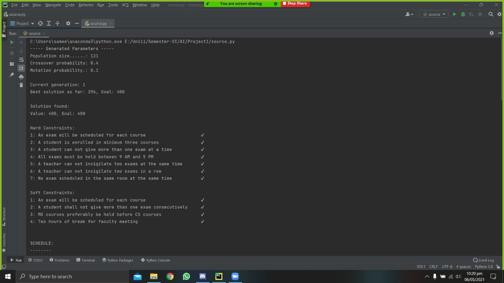
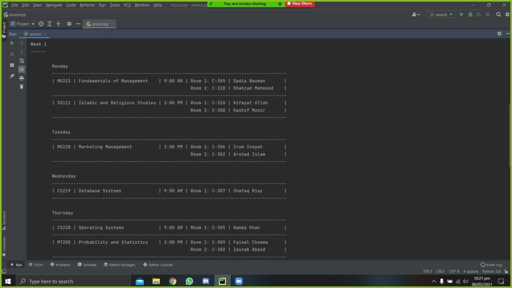
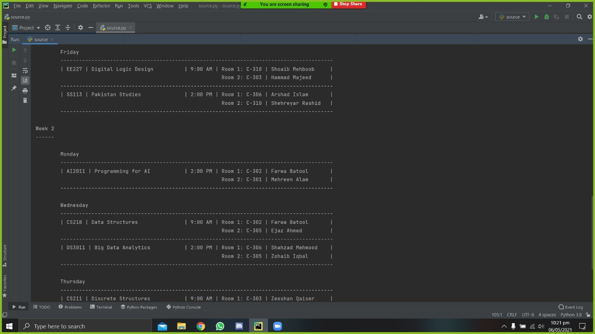
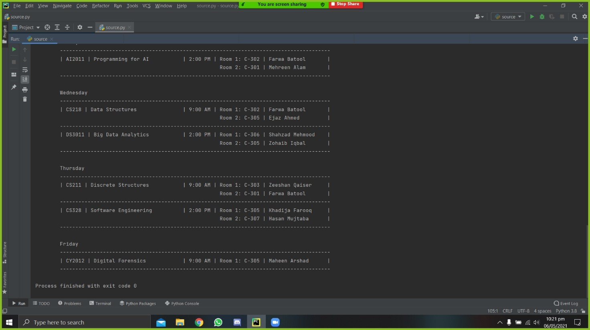

# Exam Timetable Generator using a Genetic Algorithm

A constraint-based university exam scheduler implemented in Python. The project evolves candidate timetables against student, room, invigilator, and ordering constraints using selection, crossover, mutation, and fitness scoring.


## What it demonstrates

- Chromosome-based timetable representation.
- Random population generation from real CSV inputs.
- Fitness evaluation for scheduling conflicts.
- Roulette-wheel selection.
- Crossover and mutation of candidate schedules.
- Multi-room allocation based on enrollment size.
- Human-readable output of the best discovered timetable.

See [Algorithm design](docs/ALGORITHM.md) for the search model. The original [project statement](Project%20Statement.pdf) and [report](Report.pdf) are also retained.

## Scheduling constraints

### Hard constraints

- Every course receives an exam.
- A student cannot sit more than one exam at the same time.
- Exams run on weekdays between 9:00 AM and 5:00 PM.
- Rooms cannot host overlapping exams.
- Each exam room has an assigned invigilator.
- An invigilator cannot supervise simultaneous exams.

### Optimization preferences

- Avoid consecutive exams for students and invigilators.
- Preserve the Friday 1:00–2:00 PM break.
- Prefer management exams before computer-science exams for affected students.
- Leave shared faculty meeting slots where possible.

## Dataset

The `src` directory contains the notebook and its inputs:

| File | Purpose |
| --- | --- |
| `courses.csv` | Course codes and names |
| `teachers.csv` | Available invigilators |
| `studentNames.csv` | Student records |
| `studentCourse.csv` | Course registrations |

## Run locally

```bash
python -m venv .venv
source .venv/bin/activate
pip install -r requirements.txt
cd src
jupyter lab main.ipynb
```

Run the notebook cells in order. The algorithm is stochastic, so convergence time and the resulting timetable can differ between executions.

## Screenshots

| Evolution progress | Generated timetable |
| --- | --- |
|  |  |

| Schedule continuation | Fitness result |
| --- | --- |
|  |  |

## Contributors

- [Sameet Asadullah](https://github.com/SameetAsadullah)
- [Aysha Noor](https://github.com/ayshanoorr)

## License

Licensed under the [MIT License](LICENSE).
